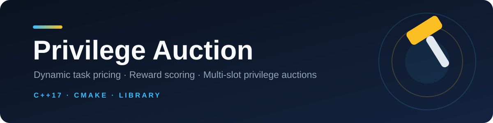

# Privilege-Auction-OPD

🇬🇧 [English](README.md) | 🇷🇺 [Русский](README.ru.md)

<p align="center">
  
</p>

<p align="center">
  <a href="https://github.com/Privilege-Auction/Privilege-Auction-OPD/actions/workflows/ci.yml">
    
  </a>
  
  
</p>

---

## About

C++ library for gamification systems with **dynamic task pricing** and **privilege auctions**. Provides a clean API for calculating task rewards based on time, complexity, and attempts, and running English-style auctions.

**Key features:**
- Strict types (`UserId`, `TaskId`, `AuctionId`) — no ID mix-ups at compile time
- Pimpl-based `Engine` — stable ABI, hide implementation
- Formulas from the spec: `Score = Base + (M × K₁ × K₂ × K₃) − Penalty`
- Auction with auto-calculated starting price: `Cost × Demand × Rarity`
- Multi-slot English auctions with automatic refunds for displaced bidders

---

## Quick Start

```cpp
#include "pa/pa.hpp"
#include <chrono>
#include <iostream>

int main() {
    pa::Engine engine;

    // 1. Add users
    auto alice = engine.add_user("Alice", 1000);
    auto bob   = engine.add_user("Bob",   1500);

    // 2. Create a task (rank B → multiplier M=5, base 300)
    pa::TaskComplexity complexity = {
        /*volume=*/4.0, /*difficulty=*/3.0, /*risk=*/2.0,
        /*w_volume=*/0.2, /*w_difficulty=*/0.3, /*w_risk=*/0.5
    };
    auto now = std::chrono::system_clock::now();
    auto task = engine.add_task(
        "Fix critical bug",
        pa::TaskRank::B,
        /*base_price=*/300,
        complexity,
        /*planned_time=*/now,
        /*deadline=*/now + std::chrono::hours(24)
    );

    // 3. Calculate reward (completed in 12h, 1 attempt)
    auto score = engine.calculate_final_score(
        task, now + std::chrono::hours(12), /*attempts=*/1
    );
    std::cout << "Score: " << score << "\n";  // 300 + (5*2.0*2.7*1.0) = 327

    // 4. Run an auction
    auto auction = engine.start_auction(
        /*privilege=*/pa::PrivilegeId{1},
        /*cost_price=*/100,
        /*slots=*/2,
        /*interested=*/5
    );
    engine.place_bid(auction, alice, 600);
    engine.place_bid(auction, bob,   700);
    auto winners = engine.close_auction(auction);
    std::cout << "Winners:";
    for (const auto& winner : winners) {
        std::cout << " " << winner.value;  // Bob (ID=2), Alice (ID=1)
    }
    std::cout << "\n";
}
```

---

## Build

**Windows (cmd):**
```cmd
mkdir build && cd build
cmake ..
cmake --build . --config Release
```

**Linux (bash):**
```bash
mkdir build && cd build
cmake .. -DCMAKE_BUILD_TYPE=Release
cmake --build . -j$(nproc)
```

Output: `build/lib/libPrivilege-Auction-OPD.a` (or `.so` if you switch to `SHARED` in `CMakeLists.txt`).

---

## Integration into Your Project

### 1. Copy headers

Copy `include/pa/` into your project's include path (e.g., `APP_GUI/include/pa/`).

### 2. Link the library

**CMake:**
```cmake
target_include_directories(your_app PRIVATE /path/to/pa/include)
target_link_libraries(your_app PRIVATE /path/to/libPrivilege-Auction-OPD.a)
```

**GCC/Clang directly:**
```bash
g++ main.cpp -I/path/to/pa/include -L/path/to/lib -lPrivilege-Auction-OPD -std=c++17
```

### 3. Use

```cpp
#include "pa/pa.hpp"   // single entry point
```

All public types live in namespace `pa::`.

---

## Core Concepts

| Concept | What it does |
|---|---|
| `pa::Engine` | Main facade. Owns users, tasks, auctions. Thread-unsafe — one instance per "room". |
| `TaskRank` (D/C/B/A) | Determines multiplier **M** (1/3/5/10) and validates the base price range: D 0–50, C 51–200, B 201–500, A ≥ 501. |
| `TaskComplexity` | Weighted sum of volume/difficulty/risk. Values are 1–5, weights are 0–1 and must sum to 1.0. This is **K₂**. |
| `calculate_final_score()` | Applies the full formula: `Base + (M·K₁·K₂·K₃) − Penalty`. Attempts must be ≥ 1; completion cannot precede the task start. |
| `assign_task()` | Completes a task once and credits the calculated score to the user's balance. |
| `start_auction()` | Auto-computes starting price from cost, slots, and interested count. `slots` must be at least 1. |
| `place_bid()` / `close_auction()` | English auction. Bids must reach the starting price; once all slots are filled, a new bid must beat the lowest winning bid. Displaced bidders are refunded. `close_auction()` returns the winners. |

### Pricing formula

```
T_plan = deadline − planned_time
T_fact = actual_completion_time − planned_time

Score = Base + (M × K₁ × K₂ × K₃) − Penalty

K₁ (time)     = min(3.0, T_plan / T_fact)
K₂ (strength) = w_vol·vol + w_diff·diff + w_risk·risk   (rounded to 0.1)
K₃ (attempts) = 1 − 0.15·(n−1),  n capped at 5
M (rank)      = 1 (D) / 3 (C) / 5 (B) / 10 (A)
Penalty       = 0 if T_fact ≤ T_plan
                Base × 0.15 for rank D
                Base × min(0.9, sqrt((T_fact − T_plan) / T_plan)) otherwise
```

### Auction formula

```
StartPrice = Cost × Demand × Rarity
Demand     = min(interested / slots, 3) + 1
Rarity     = 1 + 1 / slots
```

An auction has `slots` winning places. When all places are filled, a new bid must exceed the current lowest winning bid; the displaced bidder is refunded immediately.

---

## 📚 Documentation

- 📖 [Contributing Guidelines](CONTRIBUTING.md) — Git workflow, branch naming, PR rules.
- 📝 [Changelog](CHANGELOG.md) — Version history.
- 🛠️ [Development Docs](docs/) — Internal guides, architecture notes.
- 📐 [Scoring and Auction Formulas](docs/scoring.md) — Full mathematical specification.
- 💡 [Full example](example/main.cpp) — Runnable demo with all features.

---


## 👥 Contributors

<table>
  <tr>
    <td align="center">
      <a href="https://github.com/daniil-verba">
        
        <br />
        <sub><b>Daniil Verba</b></sub>
      </a>
      <br />
      <sub>API Developer</sub>
    </td>
    <td align="center">
      <a href="https://github.com/KrioGenius">
        
        <br />
        <sub><b>Ilya Ukolov</b></sub>
      </a>
      <br />
      <sub>Team Lead</sub>
    </td>
  </tr>
</table>
